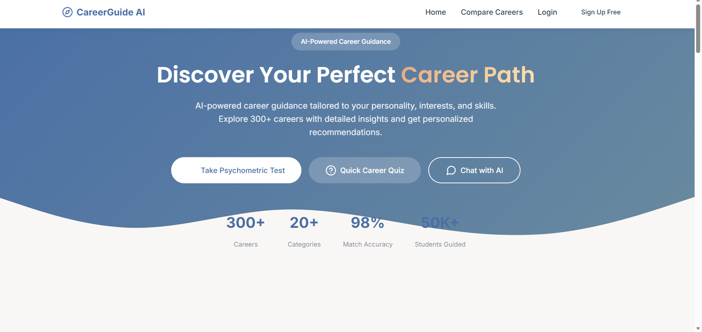
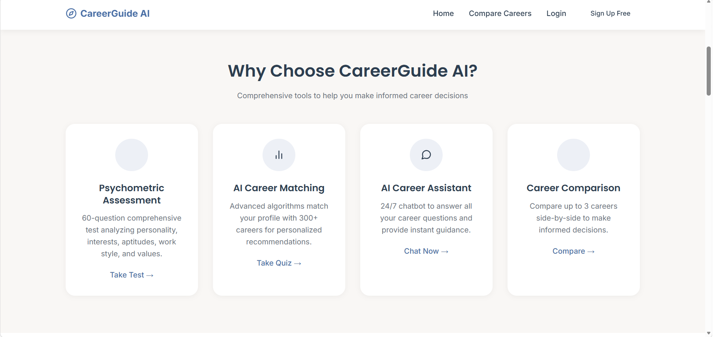

# 🎯 Career Guide AI

An AI-powered career guidance web application that helps students and graduates discover the right career through a skills quiz, psychometric assessment, IQ test and a searchable career database.


🔗 **Live Demo:** https://career-guide-ai-yr2f.onrender.com

> ⏳ Hosted on Render's free tier, so the first visit after a period of inactivity can take up to a minute to wake up.

---

## 📸 Screenshots

### Landing Page


### Features


---

## ✨ Features

- 🔍 **Career Explorer** – browse careers by category, search by name or skill, and view salary, skills, education and recruiters
- 🧠 **Career Quiz** – recommends careers using TF-IDF + cosine similarity on your stream, interests and skills
- 📝 **Psychometric Test** – personality, interests, aptitude, work-style and values assessment with a personalised report
- 🧩 **IQ Test** – logical, numerical, verbal, spatial and memory sections with score analysis
- ⚖️ **Compare Careers** – side-by-side comparison of multiple careers
- 🤖 **Career Chatbot** – ask about careers, streams and salaries
- 👤 **User Accounts & Dashboard** – register, log in and view saved results
- 🛡️ **Admin Dashboard** – user statistics, user management and action logs

## 🛠️ Tech Stack

| Layer | Technology |
|-------|------------|
| Backend | Python, Flask |
| Data / ML | Pandas, NumPy, scikit-learn (TF-IDF, cosine similarity) |
| Database | SQLite |
| Frontend | HTML, CSS, JavaScript (Jinja2 templates) |
| Server | Gunicorn |
| Hosting | Render |

## 📁 Project Structure

```
career-guide-ai/
├── app.py              # Flask app, routes and recommendation logic
├── ai_summary.py       # Report/summary generation for tests
├── database.py         # SQLite models and queries
├── wsgi.py             # Gunicorn entry point + /health endpoint
├── career.csv          # Career dataset
├── requirements.txt    # Python dependencies
├── render.yaml         # Render deployment config
├── templates/          # HTML templates
├── static/             # CSS, JS, images
└── Screenshots/        # README screenshots
```

## 🚀 Run Locally

```bash
# 1. Clone the repository
git clone https://github.com/Gayathri-Reddy874/career-guide-ai.git
cd career-guide-ai

# 2. Create and activate a virtual environment
python -m venv venv
source venv/bin/activate        # Windows: venv\Scripts\activate

# 3. Install dependencies
pip install -r requirements.txt

# 4. Create a .env file
echo "SECRET_KEY=change-this-to-a-random-string" > .env

# 5. Run the app
flask --app app run
```

Open http://127.0.0.1:5000 in your browser.

## ⚙️ Environment Variables

| Variable | Description |
|----------|-------------|
| `SECRET_KEY` | Flask session secret (use a long random value in production) |
| `PYTHON_VERSION` | Set to `3.11.9` on Render |

## ☁️ Deploy on Render

1. Push this repo to GitHub.
2. On [Render](https://render.com) click **New + → Web Service** and connect the repo.
3. Use these settings:
   - **Language:** Python 3
   - **Build Command:** `pip install -r requirements.txt`
   - **Start Command:** `gunicorn wsgi:app --bind 0.0.0.0:$PORT --workers 2 --threads 4 --timeout 120`
   - **Health Check Path:** `/health`
4. Add the `SECRET_KEY` and `PYTHON_VERSION` (`3.11.9`) environment variables and deploy.

## 🔮 Future Improvements

- Persistent database (PostgreSQL) for production
- Salted password hashing (Werkzeug)
- LLM-powered chatbot and career reports
- Resume upload and skill-gap analysis

## 👩‍💻 Author

**Mallareddygari Gayathri**
B.E. in AI & ML Engineering | Aspiring Data Analyst

- GitHub: [@Gayathri-Reddy874](https://github.com/Gayathri-Reddy874)
- LinkedIn: [your-linkedin-url](https://www.linkedin.com/in/your-linkedin-id) *(replace)*

## 📄 License

This project is licensed under the **MIT License** – see the [LICENSE](LICENSE) file for details.

---

⭐ If you found this project useful, please give it a star!
